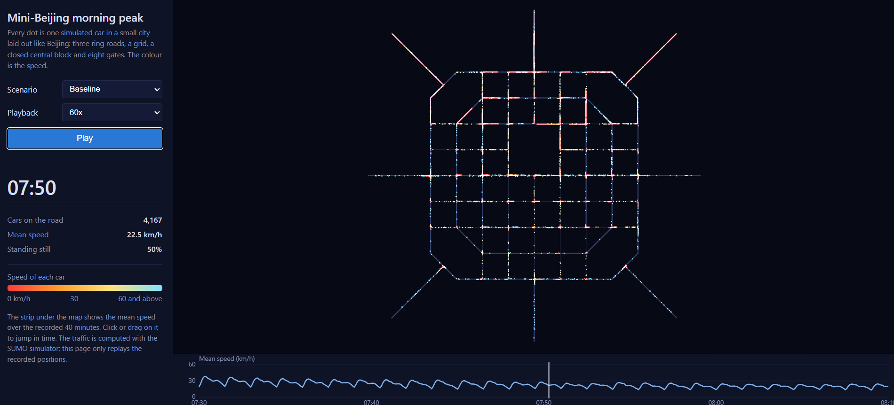
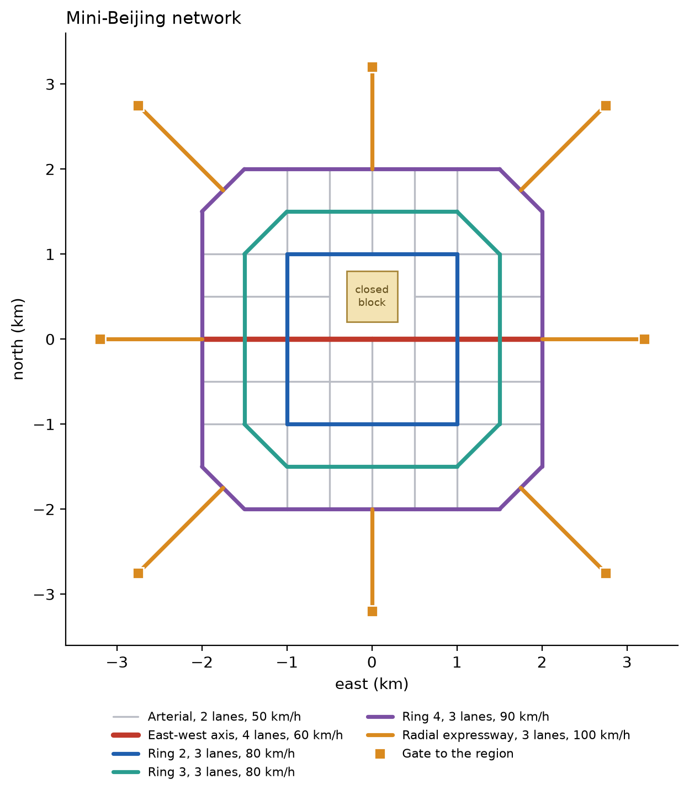
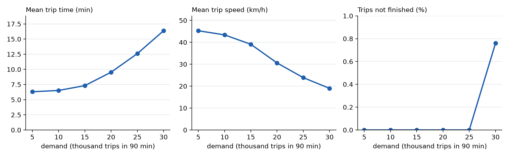
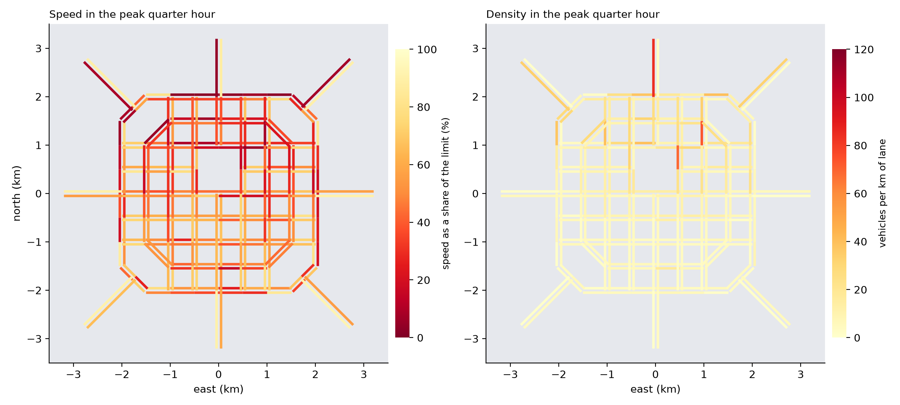
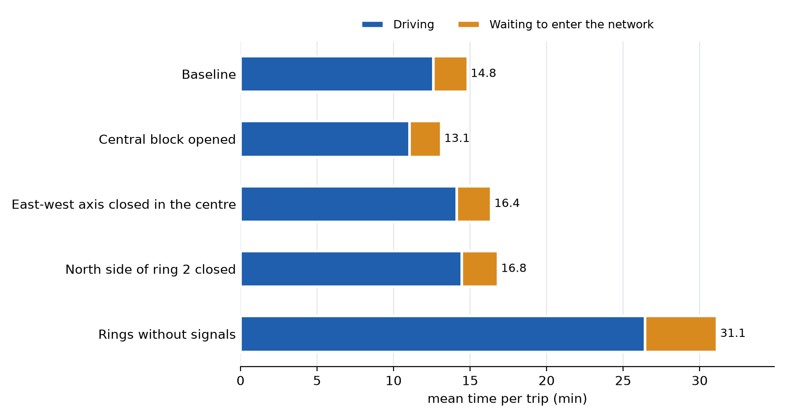
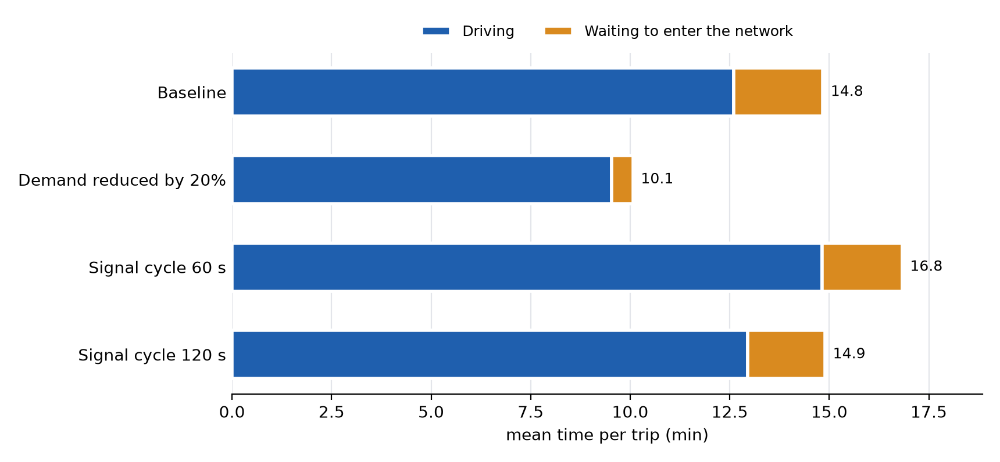
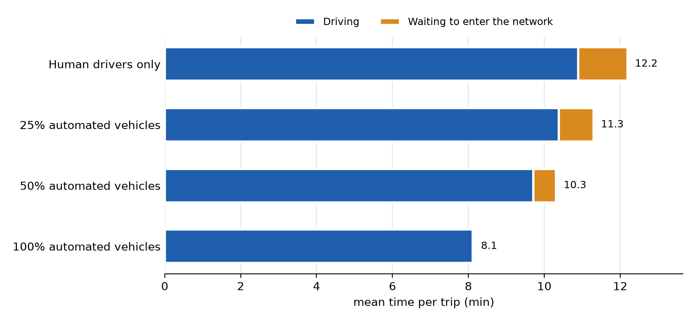
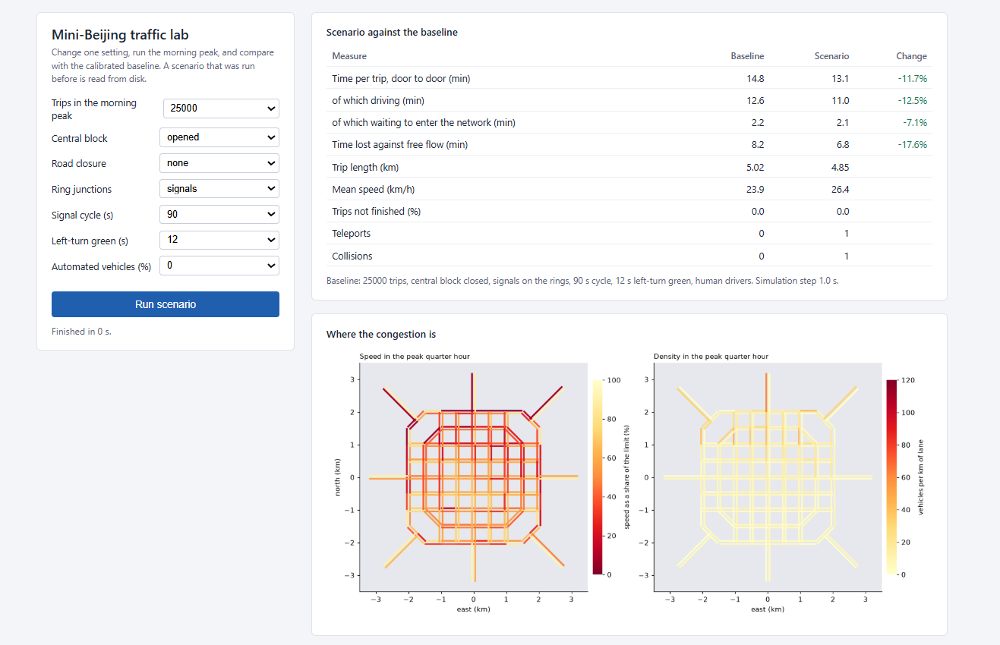

# mini-beijing

A small virtual city laid out like Beijing, simulated car by car with SUMO, and used as a laboratory: what happens to the morning peak if a road is closed, the demand is cut, the signals are changed, or the cars drive themselves?

**Watch the morning peak in the browser: https://zhangpengju0532.github.io/mini-beijing/**

Every dot is one simulated car and the colour is its speed. Four recorded scenarios can be compared. Nothing needs to be installed.

## The city

| Beijing | Here |
|---|---|
| Concentric ring roads | Rings 2, 3 and 4 with side lengths in the ratio 1 : 1.5 : 2, at one quarter of the real scale |
| Chang'an Avenue | A four-lane east-west axis that continues to the east and west gates |
| The Forbidden City interrupts the central north-south axis | One junction north of the centre is removed |
| Grid of arterials | 500 m grid |
| Radial expressways | Eight radials to eight gates |
| Dormitory districts in the north, jobs east and west of the centre | Tidal morning demand from the north to both sides of the centre |

84 nodes, 272 directed edges, 383 km of lanes, 76 signalised junctions.

## Calibration

25,000 trips in a 90-minute morning peak give a mean speed of 24 km/h, which is the range reported for central Beijing in the peak. Every vehicle arrives and there are no teleports, so the averages are trustworthy. This is the baseline for all experiments.

| Trips | Trip time (min) | Speed (km/h) | Time lost (min) |
|---|---|---|---|
| 5,000 | 6.3 | 45.3 | 2.3 |
| 15,000 | 7.3 | 39.1 | 3.2 |
| 20,000 | 9.5 | 30.6 | 5.3 |
| 25,000 | 12.6 | 23.9 | 8.2 |
| 30,000 | 16.4 | 19.0 | 11.8 |

Congestion is non-linear: 20% more demand on top of the baseline adds 44% to the time lost.

The congestion pattern is the one the layout was meant to produce: the north is slow, the south is not, and on the northern radials the inbound side is jammed while the outbound side is empty.

## Experiments

Each experiment changes one thing. Time is door to door: driving plus waiting to enter the network.

| Change | Time per trip (min) | Against baseline |
|---|---|---|
| Baseline | 14.8 | |
| Demand reduced by 20% | 10.1 | −32% |
| Central block opened | 13.1 | −12% |
| Signal cycle 120 s instead of 90 s | 14.9 | +0.4% |
| East-west axis closed in the centre | 16.4 | +10% |
| Signal cycle 60 s | 16.8 | +13% |
| North side of ring 2 closed | 16.8 | +13% |
| Rings without signals | 31.1, and 7% of the trips do not finish | +110% |

What these say:

- **Managing demand beats building.** Removing a fifth of the trips saves a third of the time, more than any change to the network.
- **One junction can be worth an arterial.** Opening the central block saves as much as closing the main axis costs.
- **Location matters more than road class.** Closing one side of ring 2, in the direction of the heaviest demand, costs more than closing the widest road in the city.
- **Removing signals does not make an expressway.** Without grade separation the side roads cannot cross the rings, and the network locks up.
- **Cycle length has a flat optimum.** Too short is expensive, too long costs almost nothing.

### Automated vehicles

| Share of automated vehicles | Time per trip (min) | Against human drivers |
|---|---|---|
| 0% | 12.2 | |
| 25% | 11.3 | −7% |
| 50% | 10.3 | −15% |
| 100% | 8.1 | −33% |

Here an automated vehicle is a car that follows at a headway of 0.6 s instead of 1.0 s and never dawdles. The result is therefore conditional on that assumption: it describes cooperative platooning, not the adaptive cruise control sold today, which keeps longer headways than human drivers do. These four runs use a simulation step of 0.5 s, because the headway must not be shorter than the step; the step itself changes the result (12.2 min against 14.8 min for the same human-driven traffic), so they are compared only with each other.

## Control panel

`panel.py` opens a local page where a scenario is chosen from seven settings, simulated, and compared with the baseline, with a congestion map. It marks results that should not be trusted: collisions, many teleports, or trips that did not finish.

## Files

| File | Purpose |
|---|---|
| `network.py` | The city: nodes, edges, road classes |
| `demand.py` | Zones, trip purposes, departure profile |
| `sim.py` | Runs SUMO and reads its statistics |
| `scenario.py` | Builds and runs one scenario from a set of options |
| `s1_map.py` | Draws the network |
| `s2_build.py` | Writes the SUMO network |
| `s3_morning_peak.py` | First morning peak |
| `s4_sweep.py`, `s4_map.py` | Demand sweep, congestion map |
| `s5_network.py`, `s5_policy.py`, `s5_av.py` | Experiments |
| `s6_record.py` | Records vehicle positions for the web page |
| `panel.py` | Local control panel |
| `view.py` | Opens a scenario in sumo-gui |
| `index.html`, `web/` | The browser replay and its data |

## Run it

Requires SUMO 1.27 with `SUMO_HOME` set, and Python 3 with `numpy`, `matplotlib` and `sumolib`.

    python s1_map.py
    python s2_build.py
    python s4_sweep.py
    python s4_map.py
    python s5_network.py
    python s5_policy.py
    python s5_av.py
    python panel.py

## Limits

The city is stylised, not a map of Beijing. Ring junctions are signalised at grade; real rings are grade-separated with ramps, so the rings here carry less than real ones. Signal plans are the defaults generated by netconvert with a fixed cycle, not optimised plans. Demand comes from a simple zone model, not from survey data. There are no buses, bicycles or pedestrians. Each scenario is one run with one random seed, so differences of a few percent are within noise.